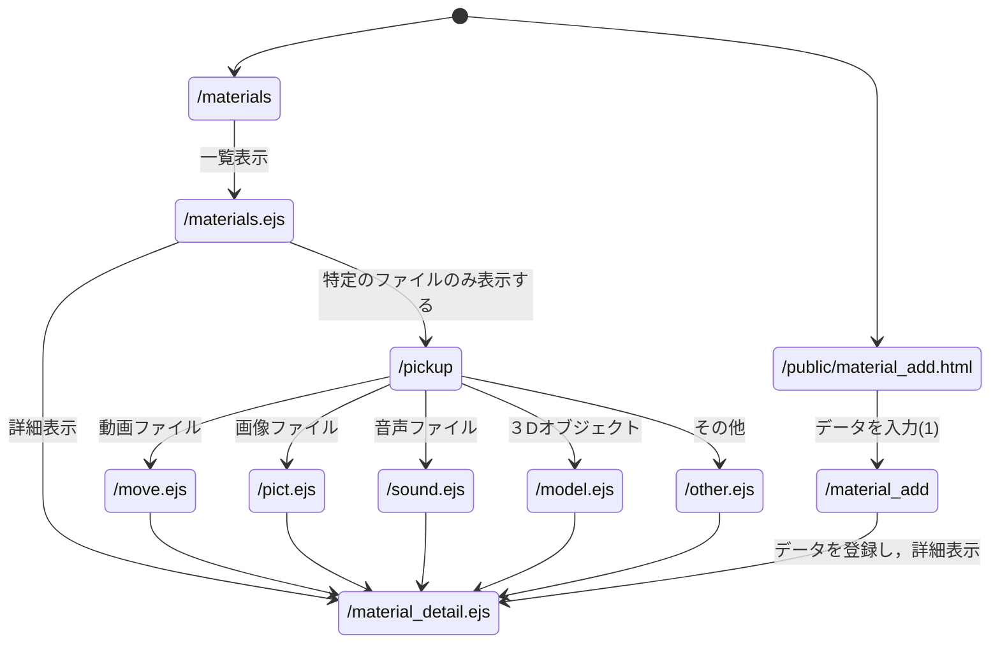

# レポート用システムのページ遷移図
## 素材ファイル管理DB
### ページ遷移図

### (1)のパラメータ
パラメータ名 | 属性 | 内容 | 値
-|-|-|-
id | number | データの登録番号 | -
type | radio | ファイルの種類 | 動画/画像/音声/3D/その他
name | text | ファイルの名称 | -
extension | text | ファイルの拡張子 | -
source | radio | ファイルのDL元 | 自作/コモンズ/booth/公式GoogleDrive/bowlroll/uploader/その他
place | radio | 保存場所 | デスクトップ/macbook/USB/GoogleDrive
memo | text | 補記 | -


## 同人活動在庫管理DB
### ページ遷移図
```mermaid
stateDiagram-v2

```

## ゲーム周回記録管理DB
### ページ遷移図
```mermaid
stateDiagram-v2

```
