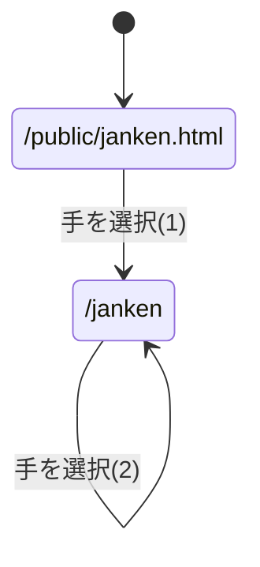
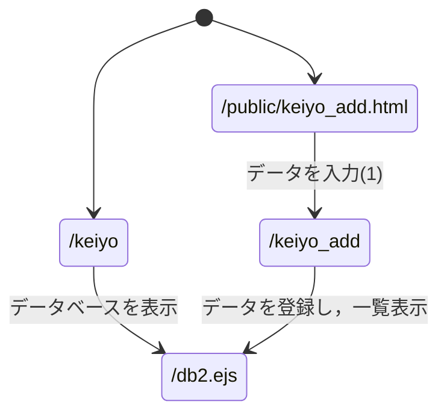
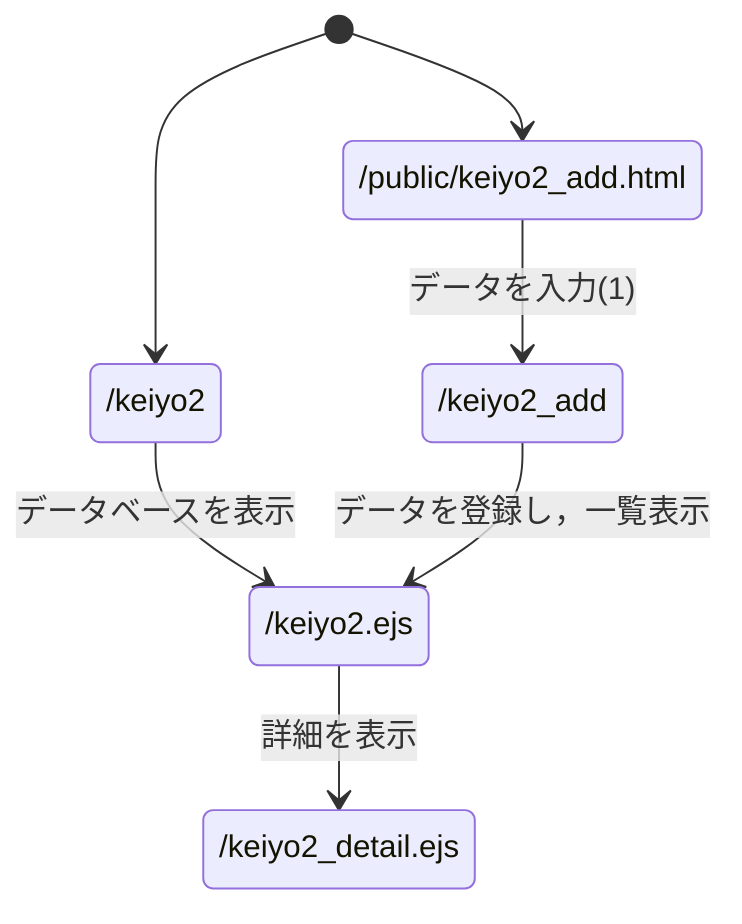
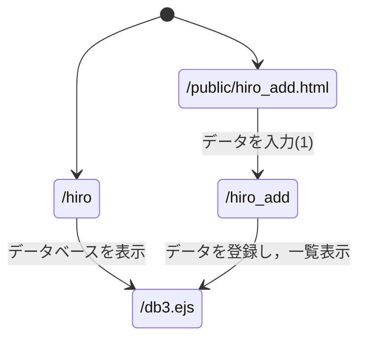

# webpro_06のページ遷移図

## 授業内作成物
### じゃんけん関係
#### ページ遷移図

#### (1)のパラメータ

パラメータ名 | 属性 | 内容 | 値
-|-|-|-
hand | text | ユーザの手 | グー/チョキ/パー
win | hidden | 勝利数 | 0
total | hidden | 対戦数 | 0

#### (2)のパラメータ

パラメータ名 | 属性 | 内容 | 値
-|-|-|-
hand | text | ユーザの手 | グー/チョキ/パー
win | hidden | 勝利数 | これまでの勝利数
total | hidden | 対戦数 | これまでの対戦数

### keiyo関係
#### ページ遷移図

#### (1)のパラメータ
パラメータ名 | 属性 | 内容
-|-|-
id | number | データの登録番号
code | text | 駅コード
name | text | 駅の名前

### keiyo2関係
#### ページ遷移図

#### (1)のパラメータ
パラメータ名 | 属性 | 内容
-|-|-
id | number | データの登録番号
code | text | 駅コード
name | text | 駅の名前
change | text | 駅の乗り換え線
passengers | text | 駅の利用者数
distance | number | 駅の東京駅からの距離

### hiro関係
#### ページ遷移図

#### (1)のパラメータ
パラメータ名 | 属性 | 内容 | 値
-|-|-|- 
id | number | データの登録番号 | -
genre | text | カードのジャンル | Pアイドル/サポカ
type | text | カードの属性 | やる気/好印象/集中/好調/全力/強気/温存/Vo/Da/Vi
name | text | カードの名称 | -